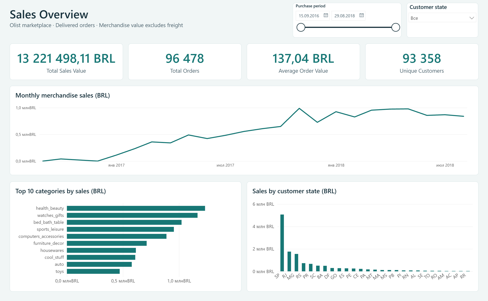
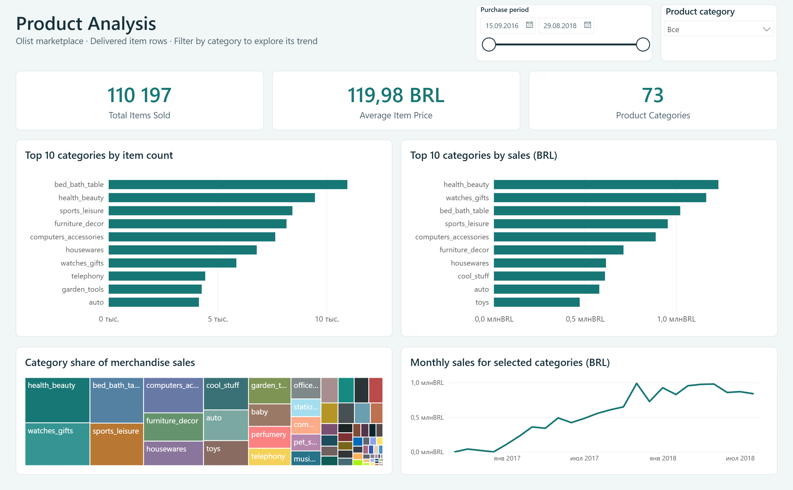

# Online Store Sales Analysis

[English](README.md) · [Русский](README.ru.md)

Sales analysis of the Olist marketplace in Brazil. The project answers how many orders customers placed, how much merchandise was sold, and which months, categories, and states drove the results. It uses **SQLite**, **Python with Pandas and Matplotlib**, **Microsoft Excel**, and **Power BI Desktop**.

## Results

| Metric | Result |
| --- | ---: |
| Orders placed, all statuses | 99,441 |
| Delivered orders | 96,478 |
| Merchandise sales on delivered orders | BRL 13,221,498.11 |
| Average order value | BRL 137.04 |
| Unique customers on delivered orders | 93,358 |
| Delivered item rows | 110,197 |
| Average delivered item price | BRL 119.98 |
| Known categories in delivered sales | 73 |

- **November 2017 was the strongest month**, with BRL 987,765.37 in delivered merchandise sales by purchase month. Twelve of the 23 months with delivered sales exceeded the monthly average of BRL 574,847.74.
- **Category leaders depended on the metric.** `health_beauty` led by sales value at BRL 1,233,131.72. `bed_bath_table` led by volume with 10,953 delivered items.
- **São Paulo (SP) led by orders.** Customers in the state placed 41,746 orders, representing 42.0% of all orders. Across the marketplace, 97.0% of orders were recorded as delivered.

## Power BI report

Open the [interactive report](powerbi/sales_dashboard.pbix) in Power BI Desktop. The imported data is included. **Sales Overview** covers sales, orders and customers with filters for purchase date and state. **Product Analysis** compares categories by volume, sales value and share with filters for purchase date and category. The [DAX measures](powerbi/measures.md) and [refresh instructions](powerbi/README.md) are included.

### Sales Overview



### Product Analysis



## Data and metric definitions

The project uses five CSVs from the [Brazilian E-Commerce Public Dataset by Olist](https://www.kaggle.com/datasets/olistbr/brazilian-ecommerce). The source records cover September 2016 through October 2018. The delivered subset used in Power BI spans September 15, 2016 through August 29, 2018. See the [source file list and key checks](data/README.md).

- **Sales value** is the sum of item prices on delivered orders, excluding freight. **Average order value** divides this amount by the number of distinct delivered orders with at least one item.
- **All-order volume, status breakdown, and state ranking by order count** include every order status and keep the 775 orders without items. The Power BI state chart shows delivered merchandise sales by the buyer's state.
- **Monthly sales** use the purchase date. The monthly average includes months with delivered sales. Products with a missing category contribute to sales under `Uncategorized`, which is excluded from the known-category count.

Kaggle lists the source data under [CC BY-NC-SA 4.0](https://creativecommons.org/licenses/by-nc-sa/4.0/). The Excel workbook and Power BI report include Olist-derived data under the same terms. The original CSVs, generated SQLite database, and Power BI import CSV are ignored by Git.

## Analysis workflow

| Tool | Work performed | Where to look |
| --- | --- | --- |
| SQLite | Loaded five source tables, enforced keys, and answered ten business questions with joins and aggregations | [SQL queries](sql/sales_queries.sql) · [SQLite instructions](sql/README.md) |
| Python | Profiled the CSVs, validated joins, reconciled all ten SQL results, and plotted four charts | [Executed Jupyter Notebook](notebooks/sales_analysis.ipynb) |
| Excel | Checked metrics with formulas and three native PivotTables for monthly sales, category sales, and orders by state | [Excel workbook](excel/sales_analysis.xlsx) |
| Power BI | Built two interactive pages on an item-level model with DAX measures | [Report and refresh instructions](powerbi/README.md) |

The joins preserved item counts and price totals. The delivered order count, sales value, and average order value agreed across all four tools to the displayed precision. The Excel pivots agreed with SQLite by month, category, and state. Power BI date, state, and category filters were checked against calculations on the import data.

## Reproduce the analysis

1. Download the five CSVs listed in the [data guide](data/README.md) and extract them into `data/`.
2. From the repository root, create the database and run JupyterLab with Python 3. Run all cells in `notebooks/sales_analysis.ipynb`.

   ```powershell
   python -m pip install -r requirements.txt
   python sql/create_database.py
   python -m jupyterlab
   ```

3. Run the SQL statements in a SQLite client. Open the Excel workbook in Microsoft Excel to inspect its formulas and refresh the PivotTables.
4. To refresh Power BI from a local copy of the data, create the report's CSV and update its `SalesCsvPath` parameter as described in the [refresh guide](powerbi/README.md).

   ```powershell
   python powerbi/prepare_data.py
   ```
