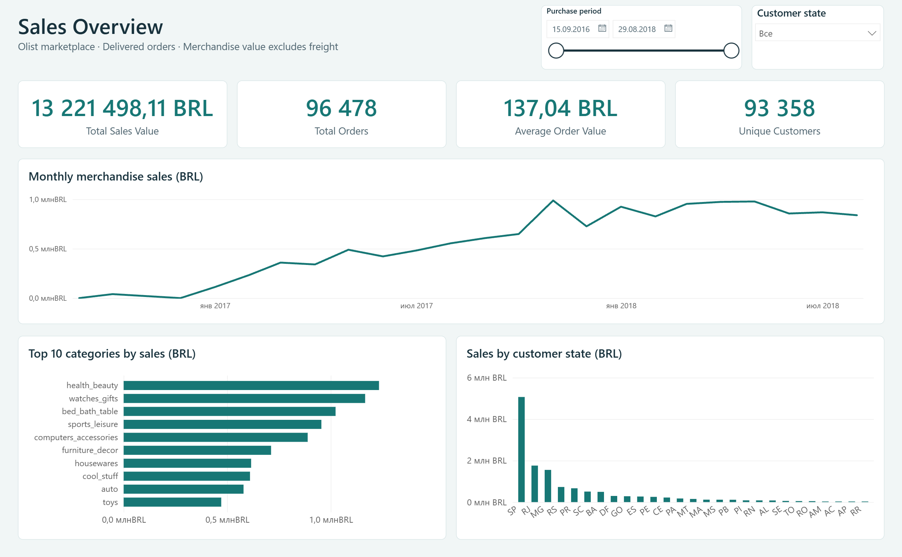
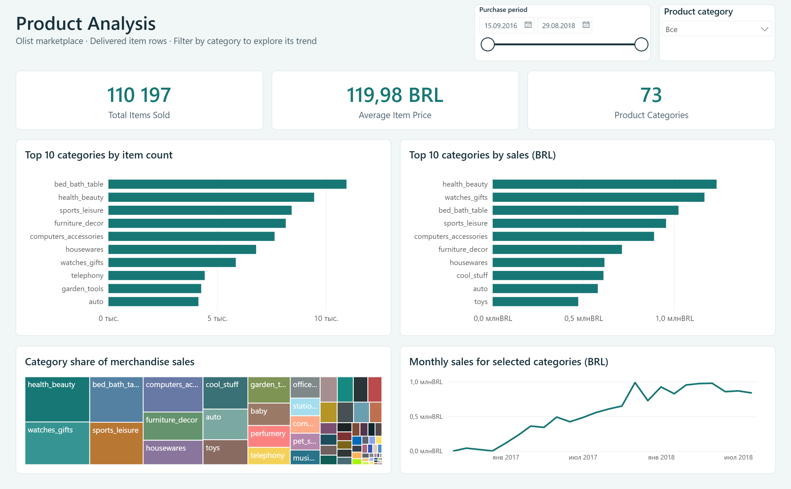

# Анализ продаж интернет-магазина

[English](README.md) · [Русский](README.ru.md)

Анализ продаж бразильского маркетплейса Olist. Проект показывает, сколько заказов оформили покупатели, на какую сумму были проданы товары и какие месяцы, категории и штаты дали наибольший вклад. Использованы **SQLite**, **Python (Pandas и Matplotlib)**, **Microsoft Excel** и **Power BI Desktop**.

## Результаты

| Показатель | Значение |
| --- | ---: |
| Заказы всех статусов | 99 441 |
| Доставленные заказы | 96 478 |
| Стоимость товаров в доставленных заказах | 13 221 498,11 BRL |
| Средний чек | 137,04 BRL |
| Уникальные покупатели в доставленных заказах | 93 358 |
| Доставленные товарные позиции | 110 197 |
| Средняя цена товарной позиции | 119,98 BRL |
| Известные категории в доставленных заказах | 73 |

- В ноябре 2017 года стоимость товаров достигла максимума за период - **987 765,37 BRL** по месяцу оформления заказа.
- По стоимости товаров лидировала категория `health_beauty` (**1 233 131,72 BRL**), по количеству позиций - `bed_bath_table` (**10 953**).
- Покупатели из штата Сан-Паулу (SP) оформили **41 746 заказов**, или **42,0%** всех заказов.

## Отчёт Power BI

В [интерактивный отчёт](powerbi/sales_dashboard.pbix) встроены данные о доставленных позициях. На странице **Sales Overview** доступны срезы по периоду и штату, на странице **Product Analysis** - по периоду и категории. См. [меры DAX](powerbi/measures.ru.md) и [инструкцию по обновлению](powerbi/README.ru.md).

### Sales Overview



### Product Analysis



## Данные и правила расчёта

Использованы пять файлов из [открытого датасета Olist](https://www.kaggle.com/datasets/olistbr/brazilian-ecommerce). Исходные заказы охватывают период с сентября 2016 по октябрь 2018 года. В отчёте Power BI представлены доставленные заказы с датами оформления с 15 сентября 2016 по 29 августа 2018 года. [Список файлов и ключей](data/README.ru.md).

- Стоимость продаж - сумма цен товарных позиций доставленных заказов без доставки. Средний чек делит эту сумму на число уникальных доставленных заказов с позициями.
- Объём заказов, статусы и рейтинг штатов по количеству заказов учитывают все статусы, включая заказы без позиций.
- Месяц определяется по дате оформления заказа. В среднее за месяц входят месяцы с доставленными продажами. Товары с пустой категорией учитываются в продажах как `Uncategorized`.

Производные данные в Excel и Power BI распространяются на условиях лицензии датасета [CC BY-NC-SA 4.0](https://creativecommons.org/licenses/by-nc-sa/4.0/). Исходные CSV, локальная SQLite-база и CSV для Power BI исключены из Git.

## Что входит в проект

| Инструмент | Результат |
| --- | --- |
| SQLite | [10 запросов](sql/sales_queries.sql) и [инструкция по созданию базы](sql/README.ru.md) |
| Python | [Выполненный ноутбук](notebooks/sales_analysis.ipynb) с проверкой данных, сверкой с SQL и четырьмя графиками |
| Excel | [Книга с формулами и тремя сводными таблицами](excel/sales_analysis.xlsx) |
| Power BI | [Две интерактивные страницы](powerbi/sales_dashboard.pbix) |

Стоимость товаров, число доставленных заказов и средний чек совпали во всех четырёх инструментах. Сводные Excel сверены с SQL по месяцам, категориям и штатам. Срезы Power BI проверены на контрольных выборках.

## Как запустить

Скачайте пять CSV из [списка источников](data/README.ru.md) и распакуйте их в `data/`. Из корня проекта выполните:

```powershell
python -m pip install -r requirements.txt
python sql/create_database.py
python -m jupyterlab
```

В JupyterLab откройте `notebooks/sales_analysis.ipynb` и выполните все ячейки. Книгу открывайте в настольном Excel, отчёт - в Power BI Desktop. Для обновления отчёта выполните `python powerbi/prepare_data.py` и укажите путь к полученному CSV в параметре `SalesCsvPath`. [Подробная инструкция](powerbi/README.ru.md).
